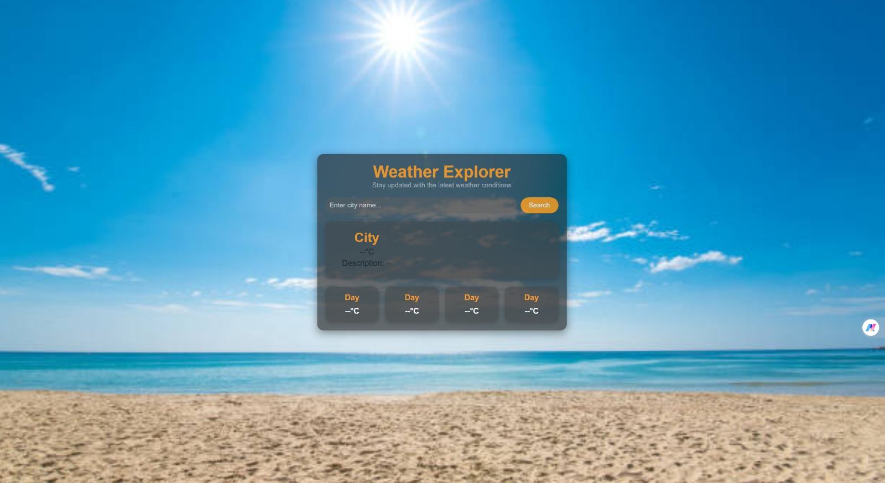
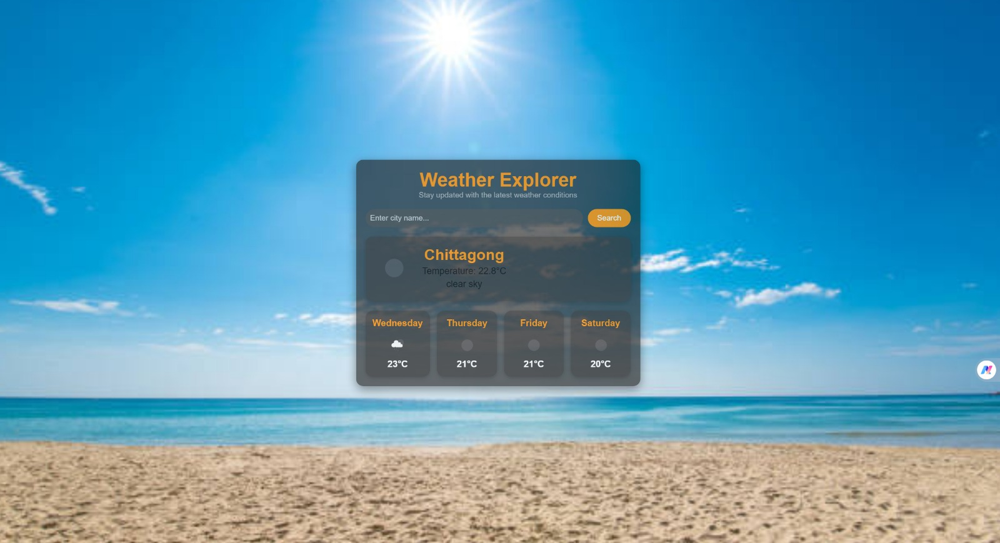

# 🌤️ Weather Explorer

A responsive weather forecast web app that shows the current weather and a 4-day forecast for any city in the world, built with HTML, CSS and JavaScript using the OpenWeatherMap API.

## 📸 Screenshots

| Home | Search: Chittagong | Search: Bandarban |
|------|--------------------|-------------------|
|  |  |  |

## ✨ Features

- Search weather by city name
- Current temperature and weather description
- 4-day forecast with weekday names, icons and temperatures
- Clean glass-style card over a beach background
- Works on desktop and mobile browsers

## 🛠️ Built With

- HTML5
- CSS3
- JavaScript (ES6, Fetch API, async/await)
- [OpenWeatherMap API](https://openweathermap.org/api)

## 🚀 How to Run

1. Clone the repository
   ```bash
   git clone https://github.com/YOUR-USERNAME/weather-explorer.git
   ```
2. Get a free API key from [OpenWeatherMap](https://home.openweathermap.org/api_keys)
3. Open `script.js` and replace `Your_own_API` with your key:
   ```js
   const apiKey = 'YOUR_KEY_HERE';
   ```
4. Open `index.html` in your browser and search for a city

> ⚠️ New OpenWeatherMap keys can take up to a couple of hours to activate.

## 📁 Project Structure

```
weather-explorer/
├── index.html     # Page structure
├── styles.css     # Styling
├── script.js      # API calls and UI logic
└── screenshots/   # App screenshots
```

## 🔮 Future Improvements

- Show an error message for invalid city names
- Dynamic background based on weather conditions
- Search by current location
- °C / °F toggle

## 👤 Author

**Your Name** – [GitHub](https://github.com/YOUR-USERNAME)
